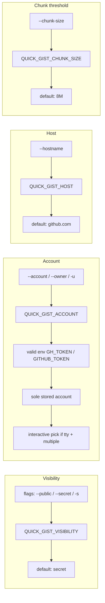

# Project Schema

`quick-gist` has **no relational persistence** — it is a single-file CLI whose only stores are the user's existing `gh` auth keyring and transient temp files. This document therefore covers the remaining data shapes per the schema-doc scope: configuration (flags/env), the `gh` command interface it speaks, transient artifacts, and the doc-pointer store. There is no ERD because there are no tables.

→ *Components ↔ files: see [PROJ-LAYOUT.md](PROJ-LAYOUT.md); runtime behavior: [PROJ-ARCH.md](PROJ-ARCH.md)*

## Configuration Schema

### Environment variables

| Variable | Default | Shape | Notes |
|----------|---------|-------|-------|
| `QUICK_GIST_VISIBILITY` | `secret` | `secret` \| `public` | Invalid values abort at startup |
| `QUICK_GIST_ACCOUNT` | *(unset)* | GitHub login string | Selects a stored `gh auth` personal account |
| `QUICK_GIST_HOST` | `github.com` | hostname | GitHub host (GHES supported) |
| `QUICK_GIST_CHUNK_SIZE` | `8M` | `^[0-9]+([KMG]?)(I?B?)$` (case-insensitive) | Parsed base-10; plain bytes or K/M/G suffix |
| `GH_TOKEN` / `GITHUB_TOKEN` | *(inherited)* | OAuth token | Caller-supplied token tried first; on failure falls back to stored-account discovery |
| `GH_HOST` | *(exported)* | hostname | Set process-locally when a stored account is selected |

### Precedence (highest wins)

## Interface Schema — `gh` invocations

| Invocation | When | Output contract |
|------------|------|-----------------|
| `gh auth status --hostname H` | Account discovery | `account <login>` substrings parsed and de-duplicated into candidates |
| `gh auth token --hostname H --user U` | Stored-account selection | Token printed on stdout (read with `env -u GH_TOKEN -u GITHUB_TOKEN`) |
| `gh api user --jq .login` | Identity verification | Non-empty login required, else abort |
| `gh gist create --desc D [--public] FILE` | Create mode | First `https?://` URL on stdout is extracted as the gist URL |
| `gh gist edit ID --add FILE` | Subsequent files; append/edit modes | Exit 0; `ID` may be a gist ID or full URL |
| `gh gist list --limit 20` | List mode | Passthrough |
| `gh gist view URL --web` | `--open` | Best-effort; failure warns but does not fail |

URL resolution: `github.com` → `https://gist.github.com/<id>`; other hosts → `https://<host>/gist/<id>`.

### File-selection filter schema

Include/exclude patterns are **bash globs** (not regex), repeatable, matched against the full relative path **or** the basename. `-x EXT` desugars to `*.EXT` (leading dot stripped). Explicit file arguments bypass filters; filters apply to the interactive picker and recursive directory inputs. Discovery prefers `rg --files --hidden` (globs via `-g`) and falls back to `find -type f` + in-script matching.

## Transient Artifacts (per run)

| Artifact | Shape | Lifetime |
|----------|-------|----------|
| Work dir | `mktemp -d "${TMPDIR:-/tmp}/quick-gist.XXXXXX"` | Removed on EXIT/INT/TERM via trap |
| `candidates` / `selected` | NUL-separated file lists (`fzf --read0 --print0`) | Work dir |
| stdin spool | `<safe_name>` (basename-validated; rejects `.`/`..`) | Work dir |
| chunk parts | `<stem>.part-NNN<ext>`, 1-based 3-digit numbering; split via `--line-bytes` when available, else `-b` | Work dir; uploaded, not persisted |
| error spools | `env-auth.err`, `auth-token.err`, `auth.err`, `create.err`, `edit.err`, `open.err` | Work dir; echoed only on failure |

## Data Files

| Path | Shape | Owner |
|------|-------|-------|
| `.meta/pointers.yaml` | Pointer records keyed by full UUIDv5 (`kind`, `token`, `file_path`, `line`, `locations[]`, `description`) | `doc-pointers build --write`; never hand-edited |
| `CHANGELOG.md` | Dated work log, newest first | Contributors, per landing |
| Gist content (remote) | Flat map of filename → text body; no duplicate basenames; parts use the `<stem>.part-NNN<ext>` naming above | GitHub, via `gh` |

## Maintenance

- Flag/env changes to the script require updating this file, `README.md` (Options/Configuration), and the summaries together.
- No migrations exist; nothing to verify against `databasechangelog`.
