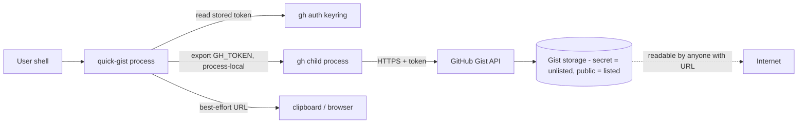

# Threat Model

## Overview

`quick-gist` is a local developer CLI with no service surface: it runs on a trusted workstation, reads the user's `gh` auth store, and publishes user-selected text files to GitHub Gists. The assets that matter are (1) GitHub OAuth tokens in the `gh` keyring, (2) the content of uploaded files once they leave the machine, and (3) the account identity that ends up owning each gist. The dominant risk class is **information disclosure of uploaded content** — everything else is local-tooling trust.

Grounding: components and data flow in [PROJ-ARCH.md](PROJ-ARCH.md); configuration and `gh` interface in [PROJ-SCHEMA.md](PROJ-SCHEMA.md).

## Attack Surface

Boundaries crossed: process ↔ keyring (token read), process ↔ child `gh` (token export), `gh` ↔ GitHub (HTTPS), GitHub ↔ internet (gist readability).

## Vulnerability Register

| ID | Severity | STRIDE | Component | Status |
|----|----------|--------|-----------|--------|
| T-001 | High | Information disclosure | "Secret" gists are unlisted, not access-controlled — anyone with the URL can read them | Accepted — inherent to GitHub Gists; secret by default and README warns explicitly |
| T-002 | Medium | Information disclosure | Sensitive-file upload is user-driven; no content scanning before publish | Open — accepted residual; user selects files (picker preview shows content) |
| T-003 | Medium | Spoofing | Stale `GH_TOKEN`/`GITHUB_TOKEN` in the environment could target the wrong account | Mitigated — env token verified via `gh api user`, actual account printed; invalid token falls back to stored-account discovery |
| T-004 | Low | Information disclosure | Selected account's token exported as `GH_TOKEN` (inherited by child processes) | Mitigated by scope — process-local only, never written to disk or logs; temp dir removed via trap |
| T-005 | Medium | Tampering / DoS | Mid-upload failure leaves a partial gist behind | Mitigated — per-file `gist edit` calls; failure reports the surviving gist URL and exits nonzero |
| T-006 | Low | Elevation of privilege | PATH-resolved `gh`/`fzf`/`rg`/`split` are trusted; a hijacked `gh` receives the exported token | Accepted — standard workstation trust model |

## Mitigation Coverage

3 mitigated (T-003, T-004, T-005) · 2 accepted (T-001, T-006) · 1 open (T-002).

- T-003 / T-004 mitigations live in `prepare_auth` (identity verification, `env -u` token read, process-local export) — see [PROJ-SCHEMA.md](PROJ-SCHEMA.md#interface-schema--gh-invocations).
- T-005 mitigation lives in the incremental upload model — see [PROJ-ARCH.md](PROJ-ARCH.md#upload-model) and [howto/large-files-and-chunking.md](howto/large-files-and-chunking.md).
- No open item currently has a ticket; T-002 is a product-scope decision (content scanning), not a defect.

## Residual Risk

Accepted: gist confidentiality is bounded by GitHub's "secret = unlisted" semantics (T-001) and by the user's own file selection (T-002); local PATH binaries are trusted (T-006). Anyone needing genuinely private storage should use a private repository or object storage instead — the README states this. Binary files are rejected outright, keeping accidental large-payload disclosure to text.
